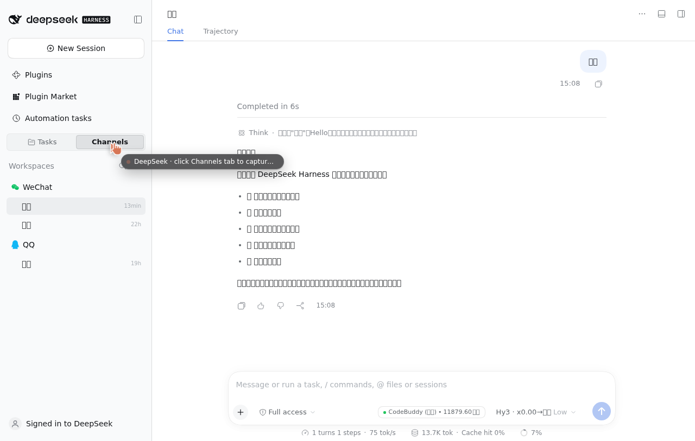

# dsh-openilink-channel

把 [OpeniLink Hub](https://github.com/openilink/openilink-hub) 的微信 Bot 接入
[DeepSeek Harness](https://github.com/deepseek-ai/deepseek-harness) 的通道插件。

参考实现：[openclaw-channel-openilink](https://github.com/openilink/openclaw-channel-openilink)
（OpenClaw 的同款通道，协议一致，宿主 SDK 不同）。

```
微信用户 ⇄ OpeniLink Hub ⇄ [dsh-openilink-channel] ⇄ dsh Agent 会话
```

- **收消息**：Hub 通过 WebSocket 推送 `message.*` 事件 → 插件把正文（含媒体元信息）
  交给对应 peer 的 Agent 会话
- **发消息**：Agent 的 `assistant/message` → 插件调 Hub Bot API 发回微信
- **图片**：带 app token 从 Hub 媒体代理下载原图，作为图片附件交给视觉模型；
  失败时退回文本链接
- **群聊**：正文前带 `[昵称 (id)]` 发送者标签，回复发回群 id
- **会话**：按 `bot + 私聊/群 + peer` 确定性派生会话 id，重启后自动 resume

### 会话显示在「频道」里

会话 id 采用 `@michengai/dsh-im-connect` 的频道约定：

```
im:weixin_openilink_<bot 摘要>:<dm|group>[:<13 位时间戳>]:<peer>
```

因此装了 IM Connect 的网页里，OpeniLink 的会话出现在侧栏 **「频道 → 微信」** 分组
（与 IM Connect 自己绑定的微信账号同组），而不是混在「任务」中。要点：

- 渠道实例 id 的平台前缀是 `weixin`，按 Bot 追加摘要（`weixin_openilink_1a2b3c4d`），
  所以不同 Bot 下同一个微信用户不会撞进同一个会话
- `/new` 之后的 id 带 13 位时间戳分段，IM Connect 会剥掉它，聊天 id 仍是 peer
- 投递仍只走本插件：IM Connect 没有 `weixin_openilink_*` 渠道适配器，不会重复发消息
- 这依赖 IM Connect 的 **私有会话约定**（不是 DSH 官方 API）；它只在启动时重建频道
  索引，所以新建的会话需要**重载 IM Connect 插件或重启 DSH** 后才出现在频道列表
- 没有安装 IM Connect 时，这些 id 只是普通会话 id，不影响收发

### 代价：IM Connect 会认领这些会话

会话既然进了它的频道索引，IM Connect 的 `bindingForSession` 就会命中它们，于是它
会接管这两个全局事件 —— 而它没有对应的渠道适配器，只能拒绝：

| 事件 | IM Connect 的行为 | 影响 |
|---|---|---|
| `approval/request` | 返回 `rejected` | 需要审批的工具被直接拒绝。`approval: never`（`danger-full-access`）的预设不会触发审批，因此没有影响 |
| `user-questions/request` | 抛「当前聊天已断开，无法在原聊天提问」 | `ask_user` 类交互在任何预设下都会失败 |

如果要用 `ask_user` 或逐步审批，请改用 A 方案（独立页签），或在 IM Connect 侧
把这些会话置为 `detached`（会同时移出频道列表）。

## 安装

**方式 A（推荐，从 GitHub 安装）**

```bash
dsh plugin --profile web add dsh-openilink-channel@github:gitMFQ/dsh-oih
```

或在 Harness Web GUI 的「设置 → 插件」里安装，包名填
`dsh-openilink-channel@github:gitMFQ/dsh-oih`。

**方式 B（本地目录 / 开发）**

```bash
git clone https://github.com/gitMFQ/dsh-oih.git
cd dsh-oih
dsh plugin --profile web add .
```

仓库根即插件包（`package.json` 在根目录），克隆后可直接安装或热改。

**方式 C（指定版本 / 提交）**

```bash
dsh plugin --profile web add dsh-openilink-channel@github:gitMFQ/dsh-oih#v0.1.0
dsh plugin --profile web add dsh-openilink-channel@github:gitMFQ/dsh-oih#<commit>
```

安装后插件即激活，配置行 id 为 `im-openilink`。

> 仓库里的 `refs/` 目录是本地参考用的上游克隆（openilink-hub、
> openclaw-channel-openilink），已加入 `.gitignore`，不会被安装。

## 配置

### 取得凭据

1. 登录你的 OpeniLink Hub
2. 进入 Bot 详情页 → 应用市场 → 安装 **OpenClaw**（或任意声明了 `message:read` +
   `message:write` 的应用）
3. 在安装详情页复制 **Hub URL** 与 **App Token**

### 填写凭据

**方式 A（推荐）**：Web GUI → 设置 → **OpeniLink 微信**，填写 Hub 地址与 App Token
后保存。保存前会先探测 `/bot/v1/info`，成功后写入 profile 的 `cordis.patch.yml`
并热重载插件，无需重启。

**方式 B**：环境变量

```bash
export OPENILINK_HUB_URL="https://hub.openilink.com"
export OPENILINK_APP_TOKEN="app_你的token"
```

**方式 C**：直接编辑 profile 的 `cordis.patch.yml`：

```yaml
- id: im-openilink
  config:
    hubUrl: https://hub.openilink.com
    appToken: app_你的token
```

### 配置项

| 字段 | 类型 | 默认 | 说明 |
|---|---|---|---|
| `hubUrl` | string | `''` | Hub 地址，如 `https://hub.openilink.com` |
| `appToken` | string (secret) | `''` | 安装实例的 App Token |
| `cwd` | string | `''` | Agent 工作目录，留空为进程当前目录 |
| `agentPreset` | string | `''` | Agent preset id，留空沿用宿主组合 |
| `provider` / `model` | string | `''` | LLM 路由，留空沿用宿主默认模型（设置页可改） |
| `reasoningEffort` | string | `''` | 推理强度（如 `off` / `low` / `high` / `max`），留空用模型默认 |
| `textChunkLimit` | int | `4000` | 单条消息最大字符数，超出按换行切分 |
| `sessionIdleMinutes` | int | `30` | 闲置会话回收时间（分钟），`0` 不回收 |
| `access.mode` | `open` \| `allow` | `open` | `allow` 时只接受白名单用户 |
| `access.allow` | string[] | `[]` | 白名单（微信 sender id） |
| `media.enabled` | bool | `true` | 是否把微信图片下载为图片附件 |
| `media.maxMB` | int | `30` | 单张图片下载上限 |
| `showReasoning` | bool | `true` | 把模型的思考（reasoning）发到微信 |
| `showTools` | bool | `true` | 把工具调用与结果发到微信 |
| `debug` | bool | `false` | 调试日志 |

## 使用

配置完成后，微信里直接给 Bot 发消息即可。插件提供：

- **`/new`**、**`/reset`**：为当前聊天开新会话（旧会话历史保留在会话列表里）
- **`/model`**：查看当前模型与可用模型列表
- **`/model provider/model`**：切换当前聊天的模型（下一条消息生效，历史上下文保留）
- **`/model reset`**：清除本聊天的覆盖，回到插件配置或宿主默认
- 群聊里 `@Bot` 或按 Hub 的匹配规则触发（取决于 Hub 侧应用配置）；
  群聊正文前带 `[昵称 (id)]`，命令识别会自动剥掉这段标签

### 回复内容

一个回合里模型的输出会分段推送到微信：

| 内容 | 前缀 | 关闭方式 |
|---|---|---|
| 思考过程（reasoning） | `🧠 思考` | `showReasoning: false` |
| 工具调用 | `🔧 调用 \`name\`` + 参数 | `showTools: false` |
| 工具结果 | `✅ 完成 \`name\`` / `⚠️ 失败 \`name\`` | `showTools: false` |
| 正文 | 无前缀 | 始终发送 |

多步工具调用会按发生顺序逐条发出，用户能在微信里看到完整的执行过程。

### Agent 工具

插件向 Agent 注册了三个工具：

| 工具 | 作用 |
|---|---|
| `openilink_send_text` | 主动向指定微信用户/群发文本 |
| `openilink_send_media` | 按 URL 发图片/文件/视频（Hub 自行下载） |
| `openilink_status` | 查看连接状态、活跃会话、最近错误 |

### 设置页



设置 → **OpeniLink 微信** 显示：

- 连接状态（已连接 / 连接中 / 未连接 / 未配置 / 异常）
- Hub 地址、Bot 名称、活跃会话列表、最近一次错误
- Hub 地址与 App Token 编辑表单（保存前探测连通性）
- **模型与回复内容**：provider / model / 推理强度（带候选下拉，来自宿主
  `llm` 服务），以及「发送思考过程」「发送工具使用」两个开关；保存即写回
  profile 并热重载，无需重启

## 实现要点

- **连接**：`/bot/v1/ws?token=...`；30s ping 心跳；断线指数退避重连（1s → 60s，带抖动）
- **出站**：监听 `session/event`，逐条转发 `assistant/message`（reasoning +
  正文）、`tool/call`、`tool/result`；`turn/end` 的 `error` 会以
  `⚠️ 本轮异常结束` 回报用户
- **模型路由**：建会话/恢复会话时按「会话覆盖 → 插件配置 → 宿主默认」取路由，
  切换模型会释放旧 Agent 并以同一会话 id 重新 resume，历史不丢
- **并发**：同一 peer 一条串行队列，消息按到达顺序处理，不会互相打断
- **媒体**：`/api/v1/channels/media` 支持 Bearer app token（Hub 的 Auth path 3），
  插件按魔数校验图片格式后再提交为附件
- **清理**：插件卸载时关闭连接、取消并释放全部会话；闲置会话按 `sessionIdleMinutes` 回收

## 开发

```bash
# 单元测试（协议解析、切分、会话派生、图片识别）
node --test test/unit.test.mjs

# 端到端协议测试（真实 WebSocket + HTTP，Agent 用替身）
MOCK_HUB_WS_MODULE=<path-to-ws> node --test test/gateway.test.mjs
```

`test/mock-hub.mjs` 是一个可复用的 Mock Hub：`/bot/v1/ws`、`/bot/v1/message/send`、
`/bot/v1/info`、`/__push`（编排入站事件）、`/replies`（读取出站）、`/media/test.png`。

## License

MIT
